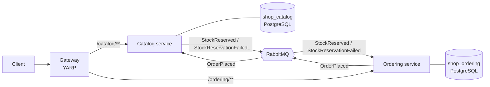
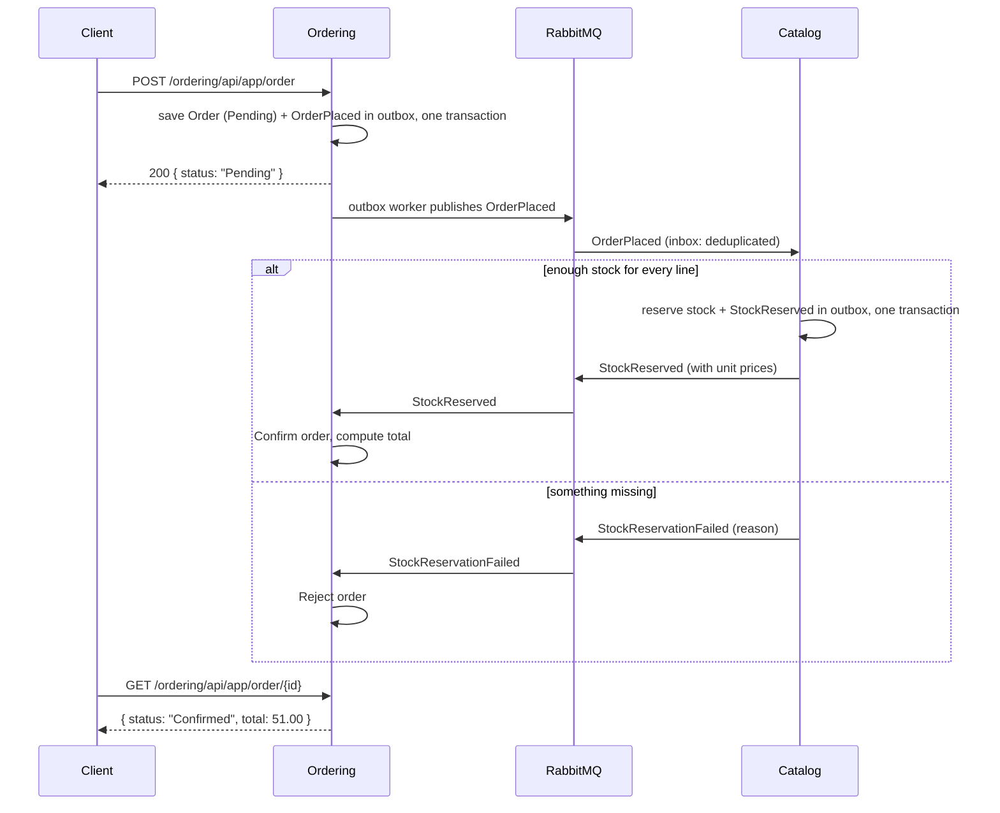

# ABP Microservices Shop

[](https://github.com/Al7assan1999/abp-microservices-shop/actions/workflows/ci.yml)

A small order-processing system split into microservices with the **ABP Framework** on **.NET 10**: two services that each own their database, talk only through **RabbitMQ** events, and sit behind a **YARP** API gateway. Ordering and stock reservation are coordinated as an event-driven saga, with ABP's **transactional outbox and inbox** so no message is lost or processed twice.

## Architecture



### Placing an order



## Design decisions

| Decision | Why |
|---|---|
| **Database per service** | Services can't couple through shared tables; each one evolves its schema independently. |
| **Events instead of service-to-service HTTP** | Ordering keeps accepting orders when Catalog is slow or down; the saga finishes when Catalog catches up. |
| **Transactional outbox** | The state change and the event it announces commit together, so you never get a reserved stock without a reply or an order nobody hears about. |
| **Inbox** | RabbitMQ delivers *at least once*; the inbox records processed message IDs so a redelivered `OrderPlaced` can't reserve stock twice. |
| **All-or-nothing reservation** | Catalog checks every line before changing anything, so a partially available order reserves nothing. |
| **Prices come from Catalog** | The client only sends product IDs and quantities; the confirmed total uses the prices Catalog reserved at. |
| **Rich domain model** | `Product.Reserve` and `Order.Confirm/Reject` enforce the invariants (no negative stock, no re-deciding an order) instead of services setting fields. |
| **Hand-written ABP modules** | Each service is a single ABP module (DDD repositories, application services exposed as auto API controllers, EF Core, event bus) without the commercial microservice template's scaffolding, so every file here is meaningful. |

## Project layout

```
src/
  Shop.Contracts/    Integration events: the only code the services share
  Shop.Catalog/      Products and stock; handles OrderPlaced
  Shop.Ordering/     Orders; handles StockReserved / StockReservationFailed
  Shop.Gateway/      YARP reverse proxy (routes in appsettings.json)
test/Shop.Tests/     Domain tests for Product and Order
deploy/              Postgres init script and the end-to-end test script
```

## Running it

```bash
docker compose up --build
```

| URL | What |
|---|---|
| http://localhost:5100/catalog/swagger | Catalog API (Swagger UI) |
| http://localhost:5100/ordering/swagger | Ordering API (Swagger UI) |
| http://localhost:15672 | RabbitMQ management (`guest` / `guest`) |

Try the whole flow with the end-to-end script (needs `curl` and `jq`):

```bash
bash deploy/e2e.sh
```

```
== Create a product with 5 in stock
== Order 2: should be confirmed at the catalog price
{"status":"Confirmed","total":51.00, ...}
== Stock went from 5 to 3
== Order 10: more than in stock, should be rejected and reserve nothing
{"status":"Rejected","rejectionReason":"Only 3 of 'Mechanical keyboard' in stock", ...}
All end-to-end checks passed.
```

## Tests and CI

- `dotnet test` runs the domain tests.
- CI builds everything, runs the tests, then starts the full stack with Docker Compose and runs `deploy/e2e.sh` against the gateway.

## Out of scope

Authentication (ABP would add an OpenIddict auth server and JWT validation at the gateway), payments, and order cancellation with stock release (a compensating event in the same style).

## License

MIT
